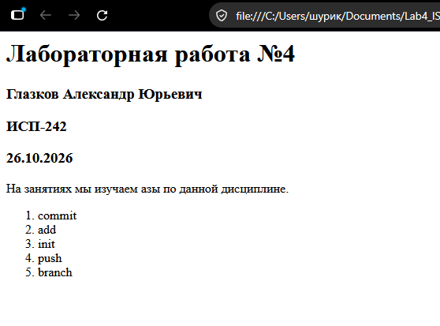

# Заголовок H1 
## Заголовок H2 
### Заголовок H3 
#### H4
##### H5
###### H6
**жирный**
_курсив_
~~зачёркнутый~~
---
***
- 1
- 2

1. 1
2. 2

3. 1 1. 00 \* 66
> Цитата

```py
print("a + b")
```

| 1   |  2  |   3 |
| :-- | :-: | --: |
| 1  | 2  |  3 |
| 1 | 2 | 3 |



[Markdown](https://markdown.org/ "Перейти на Markdown")
[Markdown](https://markdown.org/ "Перейти на Markdown")

- [ ] не сделано
- [x] сделано

> [!NOTE]
> примечание

$a^2 + b^2 = c^2$$

$$
\sum_{i=1}^n i = \frac{n(n+1)}{2}
$$